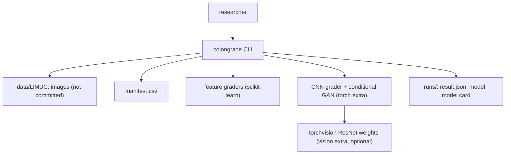
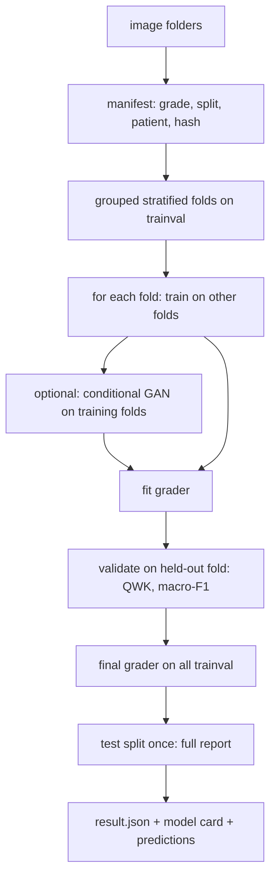

<div align="center">

# colongrade — Mayo Endoscopic Score Grading With Honest Ablations

**colongrade is a research toolkit that grades ulcerative colitis colonoscopy images on the Mayo endoscopic subscore. It takes the full LIMUC image set through these steps to a cross-validated, test-evaluated grader with a model card:**

`list all images` → `group folds by patient` → `RGB + optional contrast` → `grade (features or CNN)` → `QWK on held-out folds` → `test once` → `model card`.


**[Summary](#1-summary)** ·
**[Workflow](#4-the-end-to-end-workflow)** ·
**[Run it](#10-how-to-run-colongrade)** ·
**[Configuration](#104-environment-variables)** ·
**[Known problems](#13-known-problems)** ·
**[Glossary](#15-glossary)**

</div>

> [!NOTE]
> This README uses ASD-STE100 Simplified Technical English. The writing rules and the project
> vocabulary are in [`docs/ste-style-guide.md`](docs/ste-style-guide.md). Each term in the
> [Glossary](#15-glossary) has only one meaning.

> [!WARNING]
> Do not use colongrade to make a medical decision. It is not a medical device and it gives no diagnosis.
> A qualified clinician must review every image and every grade. Results from one dataset do not
> transfer to other centres, endoscopes or populations without a new validation.

---

colongrade grades colonoscopy images on the four ordered Mayo grades. It uses every image of the dataset and keeps the official test set apart. It groups the cross-validation folds by patient when the folders give a patient. The images stay in colour, because redness is a main Mayo sign. The main metric is the quadratic weighted kappa (QWK), because a far error is worse than a near error. Contrast equalization and GAN augmentation are explicit ablations, not hidden steps.

This README is the **one location that explains all of colongrade**. It gives these topics:

- the general design
- each component and its procedure, step by step
- the decision rules
- the data map
- the runbook
- the validation results and the known problems

| If you are… | Read |
|---|---|
| A manager or reviewer | [1](#1-summary), [3](#3-design-rules), [4](#4-the-end-to-end-workflow), [12](#12-validation-results), [14](#14-key-points) |
| A developer who joins the project | All sections, in sequence. Keep [10](#10-how-to-run-colongrade) and [13](#13-known-problems) open while you work |
| An operator who runs colongrade | [10](#10-how-to-run-colongrade), then the section for the component that you use |

---

## Table of contents

1. 🧭 [Summary](#1-summary)
2. 🏗️ [How colongrade is built](#2-how-colongrade-is-built)
   - 2.1 [Components](#21-components)
   - 2.2 [System context](#22-system-context)
   - 2.3 [Repository layout](#23-repository-layout)
3. 🛡️ [Design rules](#3-design-rules)
4. 🔄 [The end-to-end workflow](#4-the-end-to-end-workflow)
   - 4.1 [Full flow](#41-full-flow)
   - 4.2 [The life cycle of one run](#42-the-life-cycle-of-one-run)
5. 🔵 [The manifest and the images](#5-the-manifest-and-the-images)
6. 🟢 [The graders](#6-the-graders)
7. 🟣 [The conditional GAN ablation](#7-the-conditional-gan-ablation)
8. ⚖️ [The metrics and the model card](#8-the-metrics-and-the-model-card)
9. 🗂️ [Data and file map](#9-data-and-file-map)
10. ▶️ [How to run colongrade](#10-how-to-run-colongrade)
    - 10.1 [Prerequisites](#101-prerequisites) · 10.2 [Installation](#102-installation) · 10.3 [Run colongrade](#103-run-colongrade) · 10.4 [Environment variables](#104-environment-variables)
11. 🧩 [How to extend colongrade](#11-how-to-extend-colongrade)
12. ✅ [Validation results](#12-validation-results)
13. ⚠️ [Known problems](#13-known-problems)
14. 📌 [Key points](#14-key-points)
15. 📖 [Glossary](#15-glossary)
16. 📄 [License](#16-license)

---

## 1. Summary

**The problem.** A small endoscopy experiment can report a number that means nothing. The difficult questions are:

- Does the model see all images, or 20 of 11 000?
- Is the validation score from images that the model did not train on?
- Do generated images have a real grade, and are their pixel values correct?
- Does a contrast step or a GAN change the result, with an experiment to show it?
- Does the grayscale conversion remove the redness that the Mayo score depends on?
- Does the metric know that Mayo 0 called Mayo 3 is worse than Mayo 0 called Mayo 1?

colongrade gives each of these questions its own component and its own tests.

| Item | Value |
|---|---|
| Input | A LIMUC-style folder of graded images (or the synthetic drawings) |
| Output | `manifest.csv`, a run folder: `result.json`, `test_predictions.csv`, the model, `model_card.md` |
| Components | **6**: manifest, image path, feature graders, CNN grader, conditional GAN, experiment and metrics |
| Providers | None. All computation is local. ImageNet weights download only with `--pretrained` |
| Offline mode | Synthetic images, the manifest, both feature graders, the metrics, the model card. The CNN and the GAN need the `torch` extra |
| Safety | All images, patient-grouped folds, test used once, generated images only in training folds, research-only output |
| Tests | **16** unit tests pass in CI (`pytest`). The torch module (5 tests) skips without the `torch` extra. With the `torch` extra, 21 pass |


---

## 2. How colongrade is built

### 2.1 Components

| Component | Module | Purpose |
|---|---|---|
| Grades | `src/colongrade/labels.py` | Grade parsing from folder names, the active-disease split |
| Settings | `src/colongrade/config.py` | Settings from environment variables |
| Manifest | `src/colongrade/data/manifest.py` | All images, grade, split, patient, content hash, grouped folds, leak checks |
| Image path | `src/colongrade/data/images.py` | RGB loading, resize, `equalize`, `clahe`, `tanh_to_uint8` |
| Synthetic images | `src/colongrade/data/synthetic.py` | LIMUC-like folders of drawn images with Mayo cues |
| Features | `src/colongrade/features.py` | 36 colour and texture features |
| Feature graders | `src/colongrade/models/baseline.py` | Class-weighted multinomial model and ordinal threshold model |
| CNN grader | `src/colongrade/models/cnn.py` | Small residual CNN or torchvision ResNet, CORAL head, Grad-CAM (torch) |
| Conditional GAN | `src/colongrade/models/cgan.py` | Grade-conditioned generator and projection discriminator (torch) |
| Metrics | `src/colongrade/evaluate.py` | QWK, macro-F1, recall per grade, confusion, MAE, active AUC, ECE |
| Experiment | `src/colongrade/experiment.py` | Cross-validation, final model, test, permutation importance, model card, prediction |
| CLI | `src/colongrade/cli.py` | The `colongrade` command |

### 2.2 System context



### 2.3 Repository layout

```
colongrade/
├── data/README.md               LIMUC source, license, layout, manifest columns
├── docs/ste-style-guide.md      writing rules and project vocabulary
├── src/colongrade/
│   ├── data/                    manifest, image path, synthetic images
│   ├── models/                  feature graders, CNN grader, conditional GAN
│   ├── features.py              colour and texture features
│   ├── evaluate.py              ordinal metrics
│   ├── experiment.py            cross-validation, test, model card, prediction
│   ├── labels.py config.py      grades and settings
│   └── cli.py                   the colongrade command
├── tests/                       pytest suite
└── pyproject.toml               package, extras and the console script
```

---

## 3. Design rules

### 3.1 Every image
`build_manifest` lists every graded image under the root. No step takes a sub-sample. A test checks that the manifest count equals the file count.

### 3.2 Validation on held-out folds
Each fold model trains on the other folds and validates on its own fold. The final model trains on all trainval images and scores the test split one time.

### 3.3 Patients stay together
If the folders give a patient, the folds are grouped by patient. `check_manifest` stops the run if a patient or an identical file occurs in trainval and test.

### 3.4 Colour stays
`load_image` returns RGB. `equalize` and `clahe` change the luminance only and keep the colour ratios, so the redness signal stays.

### 3.5 One image path
Training, validation, test and `predict` call the same `load_image` with the same `ImageConfig`. The run folder stores the config.

### 3.6 Imbalance with weights
The graders use class weights or a weighted loss. There is no SMOTE on raw pixels.

### 3.7 Grades are ordered
The ordinal feature grader and the CORAL head model P(grade > k). The main metric is QWK.

### 3.8 Generated images are an ablation
The conditional GAN uses the real grades, trains on the training folds of each step and maps `tanh` output correctly to pixels. Generated images never enter validation or test.

---

## 4. The end-to-end workflow

### 4.1 Full flow



### 4.2 The life cycle of one run

1. `manifest` lists all images and assigns the folds. It checks for leaks.
2. `train` loads all trainval images with one `ImageConfig`.
3. For each fold, the grader trains on the other folds.
4. If the GAN ablation is on, the GAN trains on the same training folds and adds generated images.
5. The grader validates on the held-out fold. The run records QWK and macro-F1.
6. The final grader trains on all trainval images. A CNN trains for the median best epoch of the folds.
7. The final grader scores the test split one time.
8. The run writes the results, the predictions, the model and the model card.

---

## 5. The manifest and the images

**Purpose.** Give every grader all images, with leak-free folds and one image path.

| Input | Output |
|---|---|
| A root folder of graded images | `manifest.csv` with `image_id, path, mayo, split, patient, content_hash, fold` |

**Procedure**

1. Find every file with the extension `.bmp`, `.png`, `.jpg`, `.jpeg`, `.tif` or `.tiff`.
2. Read the grade from the nearest parent folder that is a Mayo grade. Skip a file with no grade folder.
3. Read the split: a top folder with `test` in its name gives `test`, else `trainval`.
4. Read the patient from a parent folder that is a number or `patient_<number>`.
5. Compute the SHA-1 hash of each file.
6. Make the folds with `StratifiedGroupKFold` (patients known) or `StratifiedKFold` (no patients).
7. Check for duplicate ids, shared patients, shared files and patients in two folds.

**Image path**

| Step | Value |
|---|---|
| Colour | RGB, float32 in [0, 1] |
| Size | `COLONGRADE_IMAGE_SIZE` square, bilinear |
| `equalize` | Global histogram equalization of the luminance, colour ratios kept |
| `clahe` | Tile equalization of the luminance with a clip limit of 2.0 and 8 × 8 tiles, bilinear blending |

---

## 6. The graders

**Purpose.** Give each image four grade probabilities.

| Grader | Input | Method | Imbalance |
|---|---|---|---|
| `features-multinomial` | 36 features | Scaler + multinomial logistic regression | `class_weight="balanced"` |
| `features-ordinal` | 36 features | Scaler + three logistic models for P(grade > k) | Balanced sample weights |
| `cnn-small` | RGB image | Compact residual CNN from scratch + CORAL head | Grade-weighted loss |
| `cnn-resnet18`, `cnn-resnet50` | RGB image | torchvision ResNet (ImageNet weights with `--pretrained`) + CORAL head | Grade-weighted loss |

**Features.** Mean, SD and percentiles of R, G and B. Mean and SD of hue, saturation and value. Redness `R / (R + G + B)`. Red minus green. Brightness-independent gradient statistics (vessel pattern). The share of bright, pale spots (fibrin). The share of dark red spots (bleeding). An 8-bin hue histogram.

**CNN procedure**

1. Normalize with the ImageNet mean and SD.
2. Augment with flips and 90-degree turns. Do not change the hue.
3. Train with AdamW (learning rate 1e-3, weight decay 1e-4) and a grade-weighted CORAL loss.
4. After each epoch, compute the validation QWK and keep a deep copy of the best weights.
5. Stop after more than 4 epochs with no improvement.

`CNNGrader.grad_cam` gives a Grad-CAM map for one image, for a visual review.

---

## 7. The conditional GAN ablation

**Purpose.** Test whether generated images help, in a fair way.

| Item | Value |
|---|---|
| Generator | Noise (64 values) plus a grade embedding, 4 transposed convolutions, `tanh` |
| Discriminator | 4 convolutions, projection of the grade embedding |
| Training | Adam (2e-4, betas 0.5 and 0.999), label smoothing 0.9, `--gan-epochs` passes over the training images |
| Output | uint8 images through `tanh_to_uint8`: (x + 1) × 127.5 |
| Use | `--gan-per-grade N` adds N generated images per grade to each training step |

**Rules**

- The GAN has four grades. A fifth class does not exist.
- The GAN trains again in each fold, on that fold's training images only.
- The image size must be a multiple of 16.

---

## 8. The metrics and the model card

| Metric | Definition |
|---|---|
| `qwk` | Quadratic weighted Cohen's kappa, with a 95 % bootstrap interval on the test split |
| `macro_f1` | Mean F1 of the four grades |
| `accuracy` | Correct images divided by all images |
| `per_grade_recall` | Recall of each grade |
| `confusion` | 4 × 4 matrix, rows are the true grades |
| `mae_grades` | Mean absolute grade error |
| `remission_vs_active_auc` | AUC of P(grade ≥ 2) for active disease against remission |
| `ece` | Expected calibration error of the top grade, 10 bins |
| `permutation_importance_test` | QWK drop when one feature is shuffled (feature graders) |

The model card states the intended use (research only), the data counts, the cross-validation and test results and the limits.

---

## 9. Data and file map

| Path | Committed? | Contents |
|---|---|---|
| `data/README.md` | Yes | Source, license, download, layout |
| `data/LIMUC/` | No (git ignores it) | The dataset images |
| `data/LIMUC/manifest.csv` | No (git ignores it) | The manifest |
| `runs/<name>/config.json` | No (git ignores it) | The experiment config |
| `runs/<name>/result.json` | No (git ignores it) | Fold results, test report, importance |
| `runs/<name>/test_predictions.csv` | No (git ignores it) | Path, true grade, predicted grade, probabilities |
| `runs/<name>/model.joblib` or `model.pt` | No (git ignores it) | The final grader |
| `runs/<name>/model_card.md` | No (git ignores it) | The model card |
| `.env.example` | Yes | Variable names only |

---

## 10. How to run colongrade

### 10.1 Prerequisites

| Need | For |
|---|---|
| Python 3.11+ | All components |
| `torch` (extra `torch`) | The CNN grader and the conditional GAN |
| `torchvision` (extra `vision`) | ResNet backbones and ImageNet weights |
| A GPU | Recommended for CNN runs on the full dataset |

### 10.2 Installation

```bash
git clone https://github.com/KrishnaAnnavaram/colongrade.git
cd colongrade
python -m venv .venv
. .venv/bin/activate            # Windows: .venv\Scripts\activate
pip install -e ".[dev]"         # core + tests
pip install -e ".[torch]"       # optional: CNN grader and GAN
pip install -e ".[vision]"      # optional: ResNet backbones
```

### 10.3 Run colongrade

```bash
# 1. offline demo: synthetic images, two feature graders, CLAHE ablation
colongrade demo
colongrade demo --neural                     # adds the small CNN and the GAN ablation (torch)

# 2. LIMUC (see data/README.md)
colongrade manifest data/LIMUC
colongrade train data/LIMUC --model features-ordinal
colongrade train data/LIMUC --model features-ordinal --contrast clahe
colongrade train data/LIMUC --model cnn-resnet18 --pretrained --epochs 20
colongrade train data/LIMUC --model cnn-resnet18 --pretrained --gan-per-grade 200 --size 128
colongrade predict runs/features-ordinal_none data/LIMUC/test_set/.../image.bmp
```

`python -m colongrade` is the same as the `colongrade` command. `predict` prints a research output with a note that it is not a diagnosis.

### 10.4 Environment variables

| Variable | Used by | Meaning |
|---|---|---|
| `COLONGRADE_DATA_DIR` | `synth` | Base folder for synthetic images. Default `data` |
| `COLONGRADE_OUT_DIR` | `train`, `demo` | Folder for the runs. Default `runs` |
| `COLONGRADE_SEED` | All | Seed for folds, models and GAN. Default `13` |
| `COLONGRADE_IMAGE_SIZE` | `train` | Square image size. Default `224` |
| `COLONGRADE_FOLDS` | `manifest`, `train` | Number of cross-validation folds. Default `5` |
| `COLONGRADE_DEVICE` | CNN, GAN | `auto`, `cpu` or `cuda`. Default `auto` |

colongrade needs no credentials.

---

## 11. How to extend colongrade

| You want to… | Do this | Code change? |
|---|---|---|
| Add a backbone | Add a branch in `build_backbone` that returns a module with `out_features` | Small |
| Add a feature | Add it in `features.extract` | Small |
| Use another dataset | Put it in grade folders, with `test` in the name of the test folder | No |
| Calibrate the probabilities | Fit temperature scaling on the validation folds | Yes |
| Grade a whole procedure | Take the most severe grade of the frames of one patient | Yes |

---

## 12. Validation results

| Validation | Result | Command |
|---|---|---|
| Unit tests (CI installs only `.[dev]`) | **16 passed, 1 skipped** (the torch module with 5 tests) | `pytest -q` |
| Unit tests with the `torch` extra | **21 passed** | `pip install -e ".[dev,torch]"`, `pytest -q` |
| Offline demo (synthetic images) | See the table below | `colongrade demo --neural` |

Offline demo on **synthetic drawings**: 40 patients, 480 images (360 trainval in 5 patient-grouped folds, 120 test from 10 other patients), 64 × 64 pixels:

| Grader | Contrast | GAN images per grade | Fold QWK (mean ± SD) | Test QWK [95 % CI] | Test macro-F1 | Active AUC |
|---|---|---|---|---|---|---|
| `features-multinomial` | none | 0 | 0.815 ± 0.062 | 0.829 [0.751, 0.885] | 0.731 | 0.964 |
| `features-ordinal` | none | 0 | 0.815 ± 0.057 | 0.825 [0.750, 0.884] | 0.722 | 0.963 |
| `features-ordinal` | `clahe` | 0 | 0.782 ± 0.052 | 0.774 [0.685, 0.846] | 0.624 | 0.933 |
| `cnn-small` | none | 0 | 0.605 ± 0.100 | 0.597 [0.445, 0.720] | 0.323 | 0.924 |
| `cnn-small` | none | 25 | 0.652 ± 0.082 | 0.556 [0.410, 0.679] | 0.286 | 0.885 |

These numbers show that the pipeline runs end to end and that the ablations are measurable. On these drawings, CLAHE lowers the QWK of the feature grader, because it changes the brightness statistics that the features use. The small CNN trains from scratch on 360 images of 64 × 64 pixels for at most 15 epochs, so it stays below the feature graders. The GAN images raise the fold QWK of the CNN but lower its test QWK, and the intervals overlap. That is no evidence for GAN augmentation. The CNN rows took about 5 minutes each on a laptop CPU. The drawings are not endoscopy images, so the numbers say nothing about real performance.

The prototype reported accuracy values from 20 test images. Those are prototype results, not reproduced here. With 5 images per grade, one image changes the accuracy by 5 points, so this project does not compare with them.

---

## 13. Known problems

Read these problems before you use colongrade results in a publication.

| # | Area | Problem | Impact and action |
|---|---|---|---|
| 1 | Results | No LIMUC result is in this repository. CI uses synthetic drawings only | Run `manifest` and `train` on LIMUC and publish the run folder without the images |
| 2 | Patients | If the dataset folders give no patient, frames of one patient can sit in two folds | Add a patient column to the manifest before the folds, if you have the information |
| 3 | Frames | The grade is per frame. The clinical Mayo score uses the worst segment | Add a per-procedure aggregation |
| 4 | Labels | Neighbour grades are often confused by expert raters too | Report QWK and the confusion matrix, not accuracy alone |
| 5 | Calibration | The probabilities are not calibrated | Use ECE in the report and add temperature scaling |
| 6 | GAN | The GAN quality is not measured with FID | Check generated images by eye and with the feature grader before you trust the ablation |
| 7 | Generalization | One dataset and one centre | Validate on another centre before any clinical study |
| 8 | Bias | Mucosa tone, endoscope type and bowel preparation change the colour | Report results per subgroup when the metadata exists |

---

## 14. Key points

1. **All images, patient-grouped folds.** The manifest lists every image and stops on a leak.
2. **Validation on unseen images.** Folds validate on held-out images, and the test split is used once.
3. **Colour stays.** Contrast steps change the luminance only, so redness stays a signal.
4. **Ordered grades, ordered metric.** Ordinal models and QWK treat far errors as worse.
5. **Ablations are experiments.** CLAHE and the conditional GAN are flags with measured results.
6. **Research output only.** Every prediction and model card says that a clinician must review it.

---

## 15. Glossary

| Term | Meaning |
|---|---|
| **Image** | One colonoscopy frame with one grade |
| **Grade** | The Mayo endoscopic subscore: 0, 1, 2 or 3 |
| **Active disease** | Grade 2 or 3 |
| **Manifest** | The table of all images with grade, split, patient and fold |
| **Split** | `trainval` or `test` |
| **Fold** | One grouped cross-validation part of `trainval` |
| **Patient** | The patient id from a folder name |
| **Contrast mode** | `none`, `equalize` or `clahe` on the luminance |
| **Grader** | A model that gives four grade probabilities |
| **CORAL head** | One score with three ordered thresholds |
| **Conditional GAN** | The generator and discriminator that draw images for a given grade |
| **Generated image** | An image from the conditional GAN |
| **Synthetic image** | A drawing from `colongrade synth` |
| **Run** | One experiment folder |
| **QWK** | Quadratic weighted kappa |
| **Model card** | The intended use, data, results and limits of a run |

---

## 16. License

[MIT](LICENSE) © 2026 Krishna Annavaram
